<p align="center">
    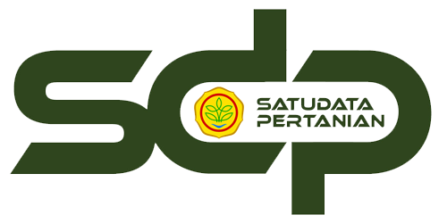
</p>

<p align="center">
  <em>A centralized agricultural data platform for exploring datasets, accessing official publications, and managing agricultural information.</em>
</p>

<p align="center">
  <a href="https://sdp.pertanian.go.id/">
    <strong>🌐 Visit SDP</strong>
  </a>
</p>

<p align="center">
  
  &nbsp;&nbsp;
  
  &nbsp;&nbsp;
  
  &nbsp;&nbsp;
  
  &nbsp;&nbsp;
  
  &nbsp;&nbsp;
  
  &nbsp;&nbsp;
  
  &nbsp;&nbsp;
  <picture>
    <source media="(prefers-color-scheme: dark)" srcset="assets/icon/radix-ui-dark.svg" />
    <source media="(prefers-color-scheme: light)" srcset="assets/icon/radix-ui.svg" />
    
  </picture>
  &nbsp;&nbsp;
  
</p>

## 🌟 Core Features

- **Centralized Agricultural Data Catalog:** Provides a searchable and filterable public repository of agricultural statistical and geospatial datasets, including regional commodity distribution, harvested areas, and priority metrics.
- **Official Publications & Multimedia Gallery:** Enables public access to ministry reports, statistical newsletters, infographics, press galleries, and video documentation.
- **Agricultural Data Management:** Provides administrative interfaces for managing datasets, variables, indicators, and associated data files.
- **News & Content Management:** Enables administrators to create, edit, and publish official news articles, infographics, reports, and multimedia content.
- **Priority Data Verification:** Supports administrative workflows for reviewing and verifying priority agricultural data before publication.
- **Role-Based Administrative Access:** Provides role-restricted dashboards and management capabilities for authorized personnel.

## 🚀 Key Highlights & Impact

- **Improved Agricultural Data Accessibility:** Consolidates datasets, official publications, and multimedia resources into a centralized platform, making agricultural information easier for the public to discover and access.
- **Streamlined Content Administration:** Integrates dataset management, data verification, news publishing, and multimedia administration into a unified interface, reducing the need to manage content across disconnected systems.
- **Consistent Data Governance:** Supports structured data management and priority data verification to improve the consistency and reliability of published agricultural information.
- **Modern Full-Stack Architecture:** Integrates Laravel and React through Inertia.js, combining server-side routing and backend processing with a reactive single-page application experience without maintaining a separate API.
- **Type-Safe Frontend Development:** Uses TypeScript to improve code maintainability, detect type-related issues during development, and support more reliable form and component implementations.
- **Responsive and Efficient User Experience:** Combines Vite, Tailwind CSS v4, and modern UI libraries to support responsive interfaces and streamlined frontend asset delivery.
- **Security-Focused Implementation:** Leverages Laravel Fortify, CSRF protection, secure password hashing, server-side validation, and role-based access control to protect authentication flows and administrative operations.

## 🛠️ Technology Stack & Architectural Rationale

This project connects a robust PHP backend with a modern, reactive React frontend within a cohesive, maintainable repository.

### ⚙️ Backend

- [ **Laravel**](https://laravel.com/): Selected for its elegant syntax, expressive ORM (Eloquent), robust migration tooling, and out-of-the-box security features tailored for government-grade web applications.
- [ **PHP**](https://www.php.net/): Utilizes the latest performance enhancements, strong typing features, and modern language constructs.
- [ **Laravel Fortify**](https://laravel.com/docs/fortify): Powers headless authentication backend services including secure login flows, password resets, and session management.

### 💻 Frontend

- [ **React**](https://react.dev/): Leverages modern hooks and component-based architecture to build responsive user interfaces and interactive administrative dashboards.
- [ **Inertia.js**](https://inertiajs.com/): Bridges Laravel and React, enabling a single-page application experience using server-side routing and controllers without requiring a separate API.
- [ **TypeScript**](https://www.typescriptlang.org/): Improves frontend reliability and maintainability through static type checking across components, forms, and application data.
- [ **Tailwind CSS**](https://tailwindcss.com/): Provides utility-first styling for building responsive, consistent interfaces efficiently.
- [<picture><source media="(prefers-color-scheme: dark)" srcset="assets/icon/radix-ui-dark.svg" /><source media="(prefers-color-scheme: light)" srcset="assets/icon/radix-ui.svg" /></picture> **Radix UI**](https://www.radix-ui.com/): Supplies accessible, composable UI primitives for implementing consistent interactive components.
- [ **Ant Design**](https://ant.design/): Provides reusable UI components, including data tables and form controls, for administrative workflows.
- [ **ESLint**](https://eslint.org/) & [ **Prettier**](https://prettier.io/): Enforces strict code linting rules and formatting consistency.

## 🔒 Comprehensive Security Implementation

Security was engineered into Satu Data Pertanian from the ground up to protect sensitive statistical repositories and administrative controls:

1. **Role-Based Access Control (RBAC):** Restricts administrative endpoints (such as dataset modification, data verification, and user management) to authorized personnel only[cite: 4, 5].
2. **CSRF & XSS Protection:** Leverages Laravel's native CSRF tokens and secure session management to prevent cross-site request forgery and injection attacks.
3. **Secure Authentication Flow:** Implements robust credential verification via Laravel Fortify with encrypted session storage and secure password hashing algorithms.
4. **Input Sanitization & Validation:** All incoming administrative payloads and search parameters undergo rigorous server-side validation to maintain absolute database integrity.

## 📦 Installation & Project Structure

### 🚀 Getting Started

To set up and run the project locally, follow these steps:

1. **Clone the repository:**

   ```bash
   git clone https://github.com/username/satu-data-pertanian.git
   cd satu-data-pertanian
   ```

2. **Run the automated setup script (or manual steps below):**

   ```bash
   composer setup
   ```

   *(The setup command automatically installs PHP dependencies, copies `.env`, generates app keys, runs migrations, installs Node modules, and builds frontend assets).*

3. **Configure Environment Variables:**

   Open the `.env` file in the project root and configure the application environment, database connection, and other required settings.

   ```env
   APP_NAME="Satu Data Pertanian"
   APP_ENV=local
   APP_KEY=
   APP_DEBUG=true
   APP_URL=http://localhost
   ```

   Configure the database connection according to your local environment. The default configuration uses SQLite:

   ```env
   DB_CONNECTION=sqlite
   ```

   If you prefer MySQL, update the database configuration accordingly:

   ```env
   DB_CONNECTION=mysql
   DB_HOST=127.0.0.1
   DB_PORT=3306
   DB_DATABASE=satu_data_pertanian
   DB_USERNAME=root
   DB_PASSWORD=
   ```

   **Note:** Keep `.env` private and never commit it to version control. Use `.env.example` to share configuration templates without exposing sensitive values.

4. **Manual Development Setup:**

   If you are not using the automated setup command, run the following steps:

   ```bash
   # Install PHP dependencies
   composer install

   # Configure environment file
   cp .env.example .env
   php artisan key:generate

   # Run database migrations & seeders
   php artisan migrate --force

   # Install frontend dependencies and start development server
   npm install
   npm run dev
   ```

5. **Start the local development servers concurrently:**

   ```bash
   composer dev
   ```

### 📁 Project Structure

```text
satu-data-pertanian/
├── app/                 # Core application logic, controllers, models, and middleware
├── assets/              # Project assets
├── config/              # Application configuration files
├── database/            # Database migrations, factories, and seeders
├── public/              # Public entry point and accessible assets
├── resources/           # React components, pages, layouts, styles, and Blade views
│   └── js/
│       ├── components/  # Reusable UI components
│       ├── layouts/     # Shared application layouts
│       ├── pages/       # Inertia.js page components
│       └── types/       # TypeScript type definitions
├── routes/              # Web, admin, and settings route definitions
├── storage/             # Application files, uploads, cache, and logs
├── tests/               # Automated application tests
├── workflows/           # Project workflow-related files
├── .env.example         # Environment variable template
├── artisan              # Laravel command-line interface
├── composer.json        # PHP dependencies and Composer scripts
├── package.json         # JavaScript dependencies and npm scripts
├── vite.config.ts       # Frontend asset bundling configuration
└── README.md            # Project overview and documentation
```

**Notes:**
- Configure environment variables in `.env` using `.env.example` as a reference.
- Never commit `.env` or other files containing sensitive credentials to version control.
- `node_modules/`, build artifacts, and temporary files should not be committed to version control.
- Database schema changes should be managed through Laravel migrations.
- Uploaded files and application-generated data in `storage/` should be handled according to the project's storage and backup requirements.

## 🖥️ Application Screenshots

1. Public Home Portal
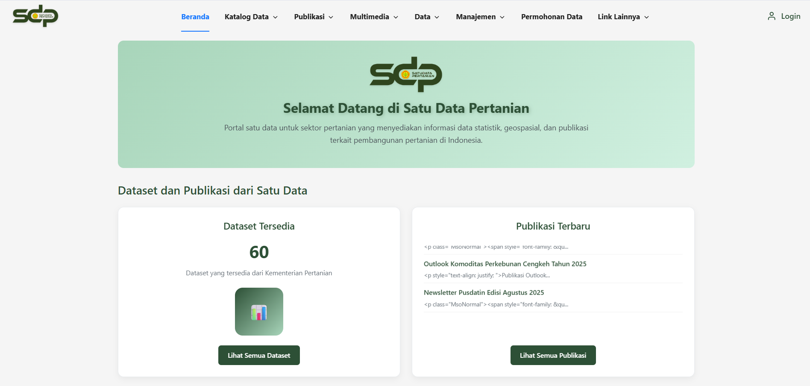

2. Dataset Catalog & Filtering
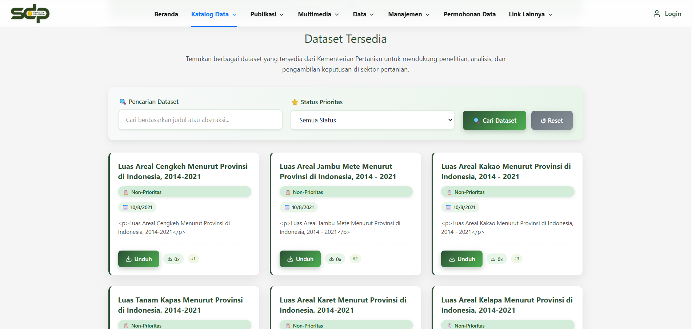

3. News Gallery & Publications
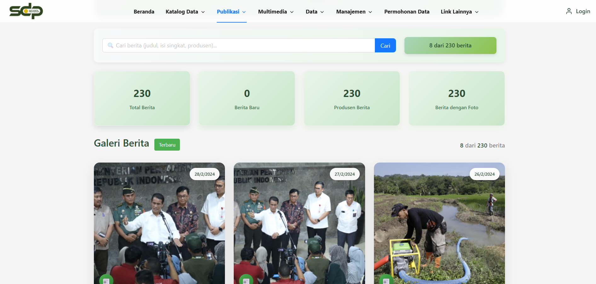

4. Admin Authentication Portal
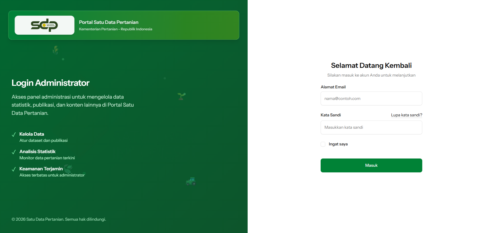

5. Administrator Control Dashboard
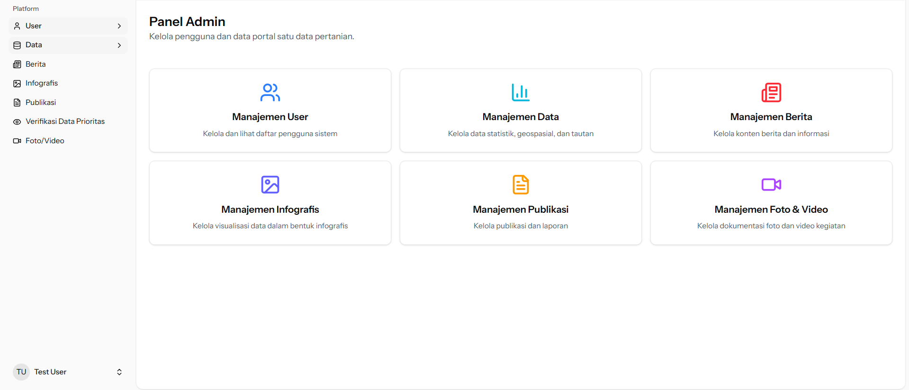

6. Data Management Panel
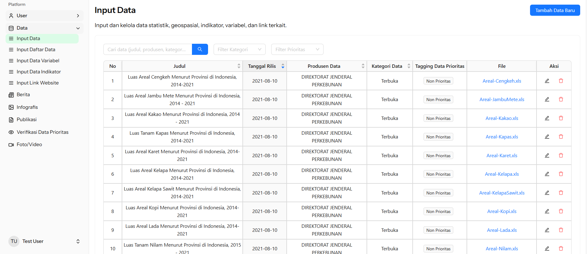

7. News & Content Management
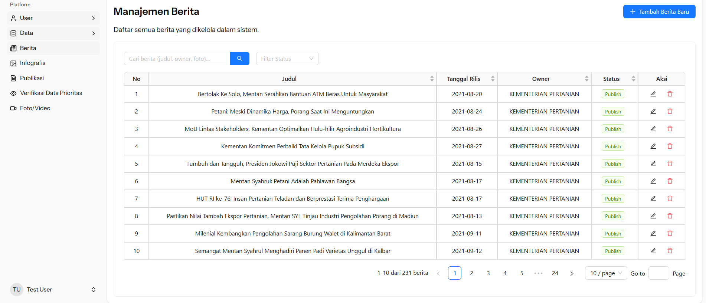

8. Infographics Management
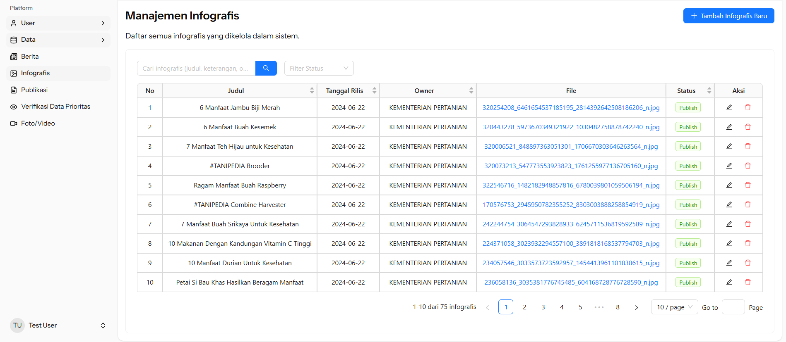

9. Publication Reports Management
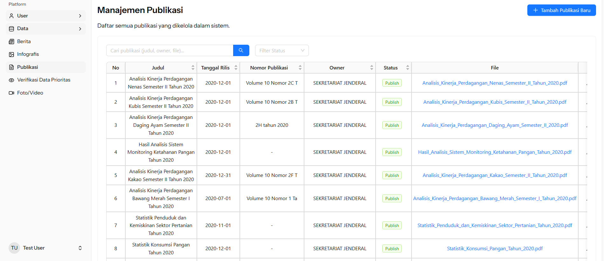

10. Multimedia & Video Gallery Management
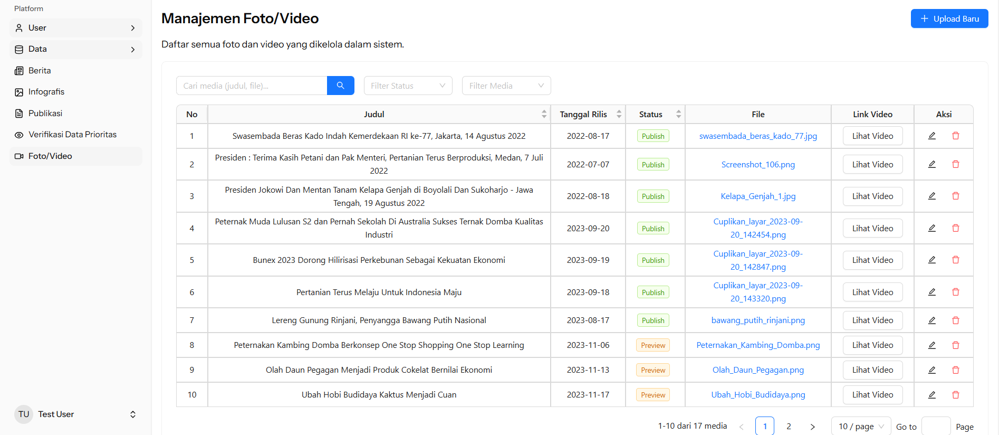

## 📚 Related Documentation

- [Laravel 12 Documentation](https://laravel.com/docs)
- [React Documentation](https://react.dev/)
- [Inertia.js Documentation](https://inertiajs.com/)
- [Tailwind CSS Documentation](https://tailwindcss.com/docs)
- [Ant Design Documentation](https://ant.design/)
- [Radix UI Documentation](https://www.radix-ui.com/)